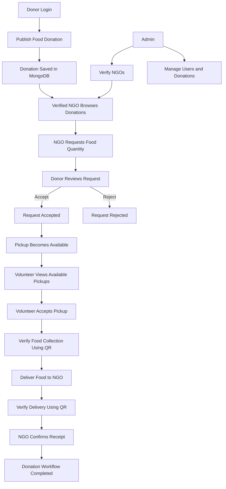

# 🍃 FoodRescue

**FoodRescue** is a MERN stack application that connects restaurants and food donors with NGOs and volunteers to reduce food waste.

Donors publish surplus food, verified NGOs request food, and volunteers help collect and deliver it.

---

## 📌 1. Problem We Solve

Restaurants, grocery stores, and bakeries often have surplus food that goes to waste. At the same time, NGOs need food to support people in need.

FoodRescue connects these people through one platform.

### Our Solution

* Donors publish available food.
* Verified NGOs discover and request food.
* Donors accept or reject requests.
* Volunteers accept available pickups.
* QR codes help verify food handovers.
* Everyone can track the donation process.

---

## 🔄 2. Complete Project Workflow



### Workflow Explained

**Step 1: Donor publishes food**

* Logs in as a donor.
* Adds food name, quantity, category, location, and pickup deadline.
* Publishes the donation.

**Step 2: NGO requests food**

* Logs in as a verified NGO.
* Searches available donations.
* Selects a donation and requests the required quantity.

**Step 3: Donor responds**

* Reviews the NGO's request.
* Accepts or rejects it.
* An accepted request can make a pickup available.

**Step 4: Volunteer accepts pickup**

* Logs in as a volunteer.
* Views available pickups.
* Accepts an eligible pickup.

**Step 5: Food collection**

* Volunteer collects the food.
* The handover is verified using a QR code.

**Step 6: Food delivery**

* Volunteer delivers the food to the NGO.
* Delivery is verified using a QR code.
* The NGO confirms receipt.

**Step 7: Completion**

* The donation and pickup workflow reaches completion.
* The platform records the relevant status changes and notifications.

**Important:** The exact sequence depends on the donation and request statuses. A newly published donation is not necessarily an assigned pickup. Volunteers generally work with available pickups rather than automatically receiving every new donation.

---

## 👥 3. User Roles

| Role      | Responsibilities                                                        |
| --------- | ----------------------------------------------------------------------- |
| Donor     | Publish food, manage donations, and respond to NGO requests             |
| NGO       | Discover food, request quantities, and confirm receipt                  |
| Volunteer | Accept pickups and verify collection and delivery                       |
| Admin     | Verify organizations and manage users, donations, and platform activity |

---

## ✨ 4. Main Features

### Donor

* Create, edit, and cancel food donations.
* Add food details and pickup deadlines.
* Accept or reject NGO requests.
* View donation history and impact statistics.
* Schedule recurring donations.

### NGO

* Search donations by category, distance, quantity, and deadline.
* View donations in list or map form.
* Request specific food quantities.
* Track request status.
* Confirm food receipt.

### Volunteer

* Manage availability.
* View available pickups.
* Accept eligible pickups.
* Use QR codes for handover verification.
* Access route links.
* Optionally share live location with consent.

### Admin

* View platform activity.
* Manage users.
* Verify organizations.
* Moderate donations.
* Review requests and pickups.
* Access reports and audit logs.

### Platform

* Authentication and role-based permissions.
* Database-backed notifications.
* Real-time updates using Socket.IO.
* Food location and map support.
* Responsive interface.

---

## 🛠️ 5. Technology Stack

### Frontend

* React
* Vite
* React Router
* Axios
* Plain CSS
* Lucide Icons
* Leaflet and OpenStreetMap
* Socket.IO Client

### Backend

* Node.js
* Express.js
* MongoDB
* Mongoose
* JWT authentication
* bcryptjs
* Socket.IO
* Zod validation

### Additional Services

* MongoDB Atlas — database hosting
* Cloudinary — food images
* SMTP — email delivery
* Redis and BullMQ — background jobs
* Vercel — frontend deployment
* Render — backend deployment

---

## 📂 6. Project Structure

```text
FoodRescue/
│
├── client/
│   ├── src/
│   │   ├── components/
│   │   ├── pages/
│   │   │   ├── auth/
│   │   │   ├── donor/
│   │   │   ├── ngo/
│   │   │   ├── volunteer/
│   │   │   ├── admin/
│   │   │   └── public/
│   │   ├── context/
│   │   ├── services/
│   │   ├── hooks/
│   │   └── css/
│   │
│   └── package.json
│
├── server/
│   ├── src/
│   │   ├── config/
│   │   ├── controllers/
│   │   ├── middleware/
│   │   ├── models/
│   │   ├── routes/
│   │   ├── services/
│   │   ├── sockets/
│   │   └── utils/
│   │
│   └── tests/
│
├── docs/
├── package.json
├── render.yaml
└── README.md
```

---

## 💻 7. Requirements

Install the following before starting:

* Node.js 20 or newer
* npm 10 or newer
* MongoDB Atlas account or a suitable MongoDB instance
* VS Code

Optional services:

* Cloudinary
* SMTP email provider
* Redis

---

## 🚀 8. Install and Run Locally

### Step 1: Open the project

Open the FoodRescue folder in VS Code.

### Step 2: Install dependencies

Run these commands from the project root:

```powershell
npm install
npm run install:all
```

### Step 3: Create environment files

Run in PowerShell from the project root:

```powershell
Copy-Item server/.env.example server/.env
Copy-Item client/.env.example client/.env
```

Fill in the environment variables required by the application.

At minimum, configure the required server settings:

* `MONGODB_URI`
* `JWT_SECRET`
* `CLIENT_URL`
* `CLIENT_ORIGINS`
* `APP_BASE_URL`

Configure the client settings:

* `VITE_API_URL`
* `VITE_SOCKET_URL`

Use the example environment files and configuration errors to identify the exact values expected by your version of the project.

**Never commit `.env` files or expose database credentials, JWT secrets, or API keys.**

### Step 4: Seed sample data

Run:

```powershell
npm run seed
```

The development seed creates sample users and a sample food donation.

The generated password is printed in the terminal. Save it when displayed.

Seed accounts include:

* `admin@foodrescue.test`
* `donor@foodrescue.test`
* `ngo@foodrescue.test`
* `volunteer@foodrescue.test`

The seed script is for local development only and refuses to run in production.

### Step 5: Start the application

From the project root:

```powershell
npm run dev
```

The expected local addresses are:

* Frontend: `http://localhost:5173`
* Backend health check: `http://localhost:5000/api/v1/health`
* API documentation: `http://localhost:5000/api/docs`

If your terminal shows different ports, use the addresses printed by the running application.

---

## 🧪 9. Test the Complete Workflow

Test the project using separate browser sessions or by logging out and switching accounts.

### Test 1: Donor

1. Log in as a donor.
2. Publish a food donation.
3. Confirm that it appears in My Donations.

### Test 2: NGO

1. Log in as a verified NGO.
2. Find the published donation.
3. Request a quantity.
4. Check the request status.

### Test 3: Donor Request Management

1. Return to the donor account.
2. Open Requests.
3. Accept or reject the NGO request.

### Test 4: Volunteer

1. Log in as a volunteer.
2. Open Pickups.
3. Check whether the accepted request has made an eligible pickup available.
4. Accept the pickup if it is available.

### Test 5: Collection and Delivery

1. Verify food collection using the QR handover flow.
2. Deliver the food.
3. Verify delivery.
4. Confirm receipt as the NGO.

### Test 6: Notifications

Check whether the relevant users receive notifications for the workflow events.

If a step fails, inspect the browser Network tab, backend terminal, API response, and relevant record in MongoDB.

---

## 🧰 10. Run Tests

From the project root:

```powershell
npm test
```

Run server tests separately:

```powershell
npm test --prefix server
```

Run the dependency-free unit tests:

```powershell
node --test server/tests/unit.test.js
```

Run client tests:

```powershell
npm test --prefix client
```

Tests must be executed in your environment before assuming that the entire application works correctly.

---

## ☁️ 11. Deployment

### Step 1: Database

Create a MongoDB Atlas cluster and database user. Configure network access and set the production `MONGODB_URI`.

### Step 2: Backend

Deploy the backend to Render using the repository configuration and the required environment variables.

Set production values for:

* `NODE_ENV`
* `MONGODB_URI`
* `JWT_SECRET`
* `CLIENT_URL`
* `CLIENT_ORIGINS`
* `APP_BASE_URL`

Configure other service variables if those services are enabled.

### Step 3: Frontend

Deploy the `client` application to Vercel.

Configure:

* `VITE_API_URL` — deployed API URL expected by the client
* `VITE_SOCKET_URL` — deployed API origin for Socket.IO

Use the exact deployed frontend origin in the backend CORS configuration.

### Step 4: Verify deployment

Check the backend health endpoint, then test login, donation publishing, NGO requests, volunteer pickups, notifications, and QR handovers.

**Do not expose development demo credentials or use them for production administrator accounts.**

For additional configuration details, see `docs/DEPLOYMENT.md`.

---

## ⚠️ 12. Important Notes

* Only verified organizations should access features that require verification.
* A published donation is not automatically an assigned pickup.
* Food requests and pickup assignments have their own workflow and status transitions.
* Exact addresses should only be shared with authorized parties at the appropriate workflow stage.
* Redis is optional locally; the application has a cron fallback for jobs.
* Cloudinary is needed for configured image uploads.
* Camera-based QR scanning requires browser permission and a secure context, such as HTTPS or localhost.
* The project must be installed, built, tested, and verified before production use.
* FoodRescue is not a food-safety certification service. Donors and organizations remain responsible for following applicable food-safety requirements.

---

## 🎯 Project Goal

FoodRescue aims to reduce food waste by connecting food donors, verified NGOs, and volunteers through a transparent and trackable donation process.

**Publish food → Request food → Accept request → Collect food → Deliver food → Confirm receipt.**
